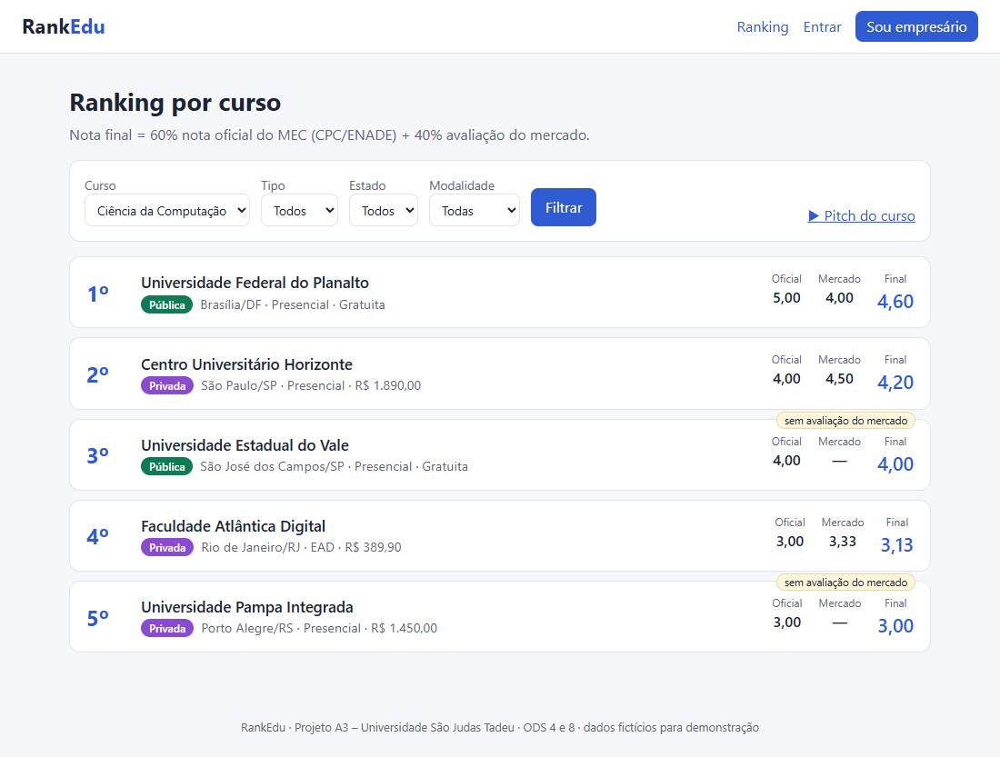
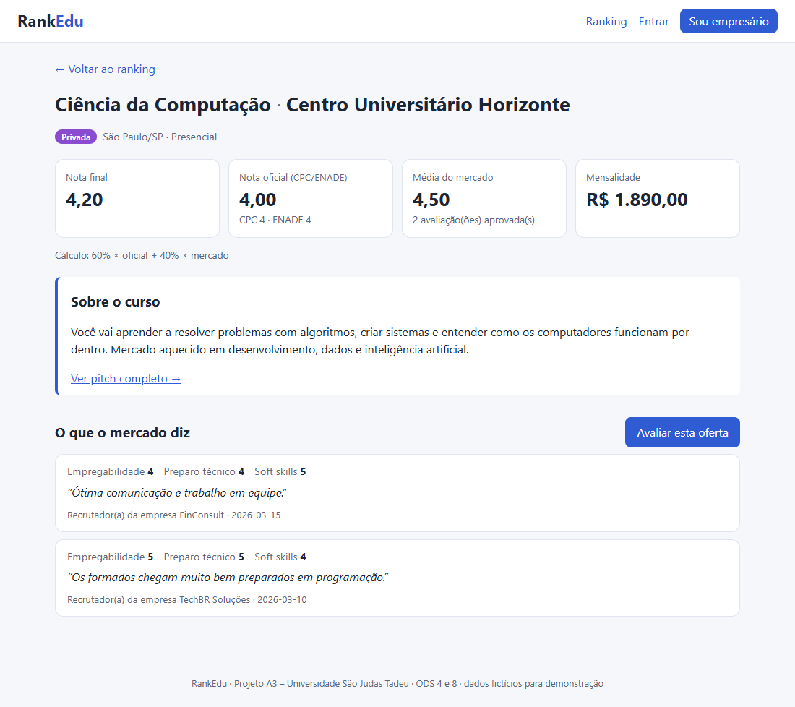
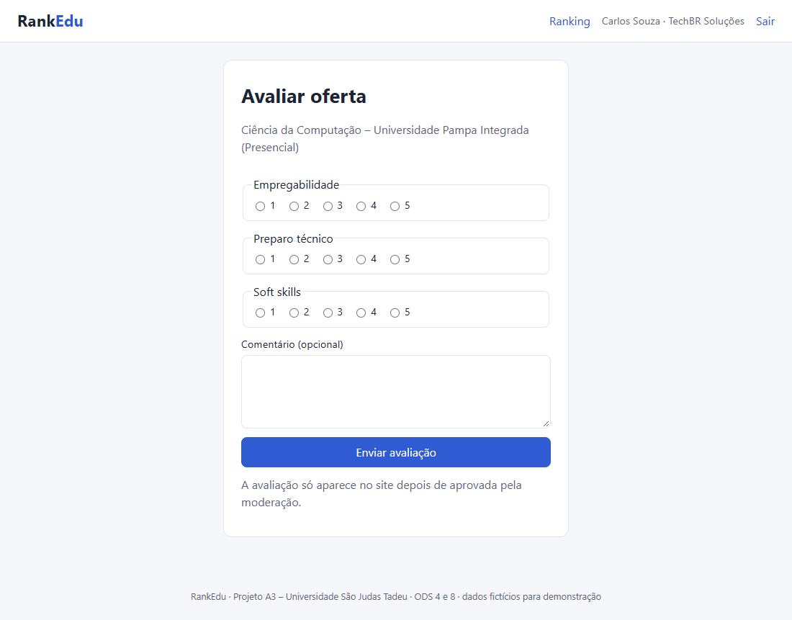
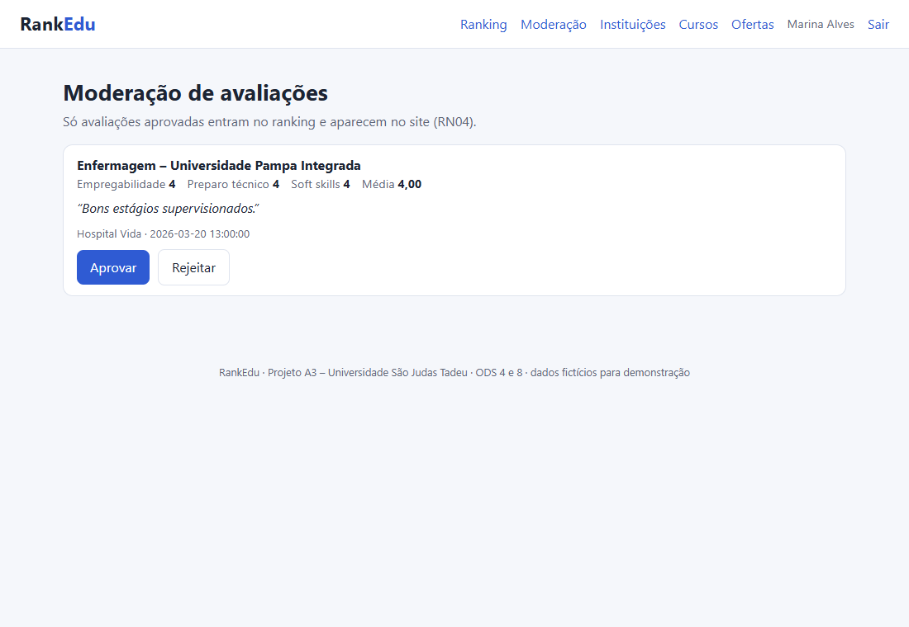

# RankEdu

Site que **ranqueia cursos de faculdades** combinando a nota oficial do MEC (CPC/ENADE) com a avaliação de
**empresários do mercado**. Ajuda quem vai escolher uma faculdade (ODS 4, educação de qualidade) a enxergar
também como o mercado de trabalho vê os formados (ODS 8, trabalho decente).

Projeto acadêmico (A3) desenvolvido por mim. A modelagem foi feita antes do código, e a implementação segue os
diagramas UML (casos de uso, classes, sequência e atividades) e o modelo físico do banco.

> Todos os dados são **fictícios** (instituições, notas e usuários), só para demonstração.

<p>
  
  
</p>

## O que o sistema faz

- **Ranking por curso** com filtros de tipo (pública/privada), estado e modalidade (presencial/EAD).
- **Nota final = 60% nota oficial** (CPC; se não houver, ENADE) **+ 40% avaliação do mercado**. Ofertas sem nota
  oficial ficam no fim do ranking.
- **Cadastro e login de empresários**, que avaliam ofertas em três critérios (empregabilidade, preparo técnico e
  soft skills) com notas de 1 a 5.
- **Moderação:** uma avaliação só entra no ranking depois de aprovada por um administrador.
- **Área do administrador:** cadastro de instituições, cursos e ofertas, além da moderação.

<p>
  
  
</p>

## Tecnologias

Python 3.10+ · Flask · SQLite (SQL puro com consultas parametrizadas, sem ORM) · Jinja2 + CSS próprio · pytest

## Rodar no computador

Precisa do [Python 3.10 ou mais novo](https://www.python.org/downloads/) (na instalação, marque
"Add python.exe to PATH").

**1. Baixe o código** para uma pasta de caminho curto, como `C:\projetos`: botão **Code → Download ZIP**
(e extraia) ou

```powershell
git clone https://github.com/Moura1106/rankedu.git C:\projetos\rankedu
```

**2a. Jeito mais fácil (Windows):** dê dois cliques em **`iniciar_demo.bat`**. Na primeira vez ele cria o
ambiente e instala o Flask; o navegador abre sozinho.

**2b. Ou passo a passo** (PowerShell, dentro da pasta do projeto):

```powershell
python -m venv .venv
.\.venv\Scripts\pip install -r requirements.txt
cd app
..\.venv\Scripts\python app.py
```

Abra http://localhost:5000. Na primeira execução o banco `app/rankedu.db` é criado sozinho a partir de
`banco/schema_sqlite.sql` e `banco/seed.sql`. Para voltar aos dados originais, apague esse arquivo ou rode
`python db.py --recriar` dentro da pasta `app`.

No Linux/macOS, troque `.\.venv\Scripts\` por `.venv/bin/`.

### Usuários de teste (senha de todos: `senha123`)

| E-mail | Perfil | Para testar |
|---|---|---|
| admin@rankedu.com | Administrador | Moderação e cadastros |
| carlos@techbr.com | Empresário | Avaliar ofertas |
| juliana@hospitalvida.com | Empresário | Avaliar ofertas |
| rafael@finconsult.com | Empresário | Avaliar ofertas |

### Roteiro rápido para explorar

1. Abra o ranking de Ciência da Computação: a Universidade Federal do Planalto fica em 1º, com nota final 4,60.
2. Filtre por **Privada** para ver só as particulares.
3. Abra a Universidade Pampa Integrada: aparece "sem avaliação do mercado", e a nota final é igual à nota oficial.
4. Entre como `carlos@techbr.com` e avalie essa oferta com 5, 5, 5. O ranking **não muda**, porque a avaliação
   ainda está pendente.
5. Saia, entre como `admin@rankedu.com`, aprove a avaliação e volte ao ranking: a nota sobe para 3,80.

### Se der erro

- **`No such file or directory` / aviso sobre "Long Path" no `pip install`:** o caminho da pasta é longo demais
  para o Windows. Mova o projeto para algo como `C:\projetos\rankedu` e rode de novo.
- **`python` não é reconhecido / abre a Microsoft Store:** instale o Python pelo site e marque
  "Add python.exe to PATH".

## Testes

```powershell
.\.venv\Scripts\python -m pytest tests -v
```

São 34 testes, um ou mais para cada regra de negócio. Cada teste usa um banco temporário e não mexe no banco real.

## Estrutura do código

| Arquivo | O que implementa | O que procurar |
|---|---|---|
| `app/models.py` | **Diagrama de classes** | `Instituicao.eh_publica()`, `OfertaCurso.nota_final()`, `AvaliacaoMercado.media()`, herança `Usuario → Empresario / Administrador`, enums |
| `app/ranking.py` | Classe `Ranking` + **diagrama de atividades** | `PESO_OFICIAL = 0.6`, `PESO_MERCADO = 0.4`; `gerar()` filtra, calcula e ordena |
| `app/controllers.py` | **Diagrama de sequência** de "avaliar oferta" | `AvaliacaoController.avaliar()` comenta cada mensagem e cada ramo do diagrama |
| `app/repositorios.py` | **Modelo físico** do banco | Um repositório por tabela, com SQL parametrizado (`?`) |
| `app/db.py` | Criação do banco | Lê `banco/schema_sqlite.sql` e `banco/seed.sql` diretamente |
| `app/app.py` | **Casos de uso** | O comentário no topo lista cada rota e o caso de uso correspondente |
| `app/templates/` | As telas | HTML com Jinja |
| `tests/` | **Regras de negócio** | Nomes como `test_notas_invalidas_rn02`, `..._rn03` |

## Regras de negócio e onde são garantidas

| Regra | No código | No banco |
|---|---|---|
| RN01 – nota final 60/40 | `Ranking.calcular_nota_final()` | view `vw_ranking` (os testes conferem que as duas dão o mesmo valor) |
| RN02 – notas de 1 a 5 | `AvaliacaoController.avaliar()` | `CHECK (... BETWEEN 1 AND 5)` |
| RN03 – uma avaliação por oferta | `avaliar()` faz UPDATE se já existir | `UNIQUE (usuario_id, oferta_curso_id)` |
| RN04 – só aprovadas contam | `OfertaCurso.avaliacoes_aprovadas()` | `DEFAULT 'PENDENTE'` |
| RN05 – só empresário avalia, com empresa e cargo | `exige_perfil(Empresario)` e o formulário de cadastro | `CHECK (perfil = 'ADMIN' OR ...)` |
| RN06 – CPC, senão ENADE, senão fim do ranking | `OfertaCurso.nota_oficial()` e `Ranking.gerar()` | `COALESCE(cpc, conceito_enade)` |
| RN07 – pública = "Gratuita" | `OfertaCurso.mensalidade_formatada()` | — |

As regras ficam **nos dois lugares** de propósito: o código dá mensagens amigáveis ao usuário, e o banco garante a
regra mesmo que alguém insira dados por fora do sistema.

## Limitações conhecidas (versão acadêmica)

- Roda com o servidor de desenvolvimento do Flask (modo debug); não é uma configuração de produção.
- Os formulários não têm proteção CSRF. Em produção, usaria a biblioteca Flask-WTF.
- Os dados são fictícios. Uma versão real usaria os dados abertos do INEP.
- Não há implantação pública: o projeto é para rodar localmente.

## Licença

[MIT](LICENSE)
